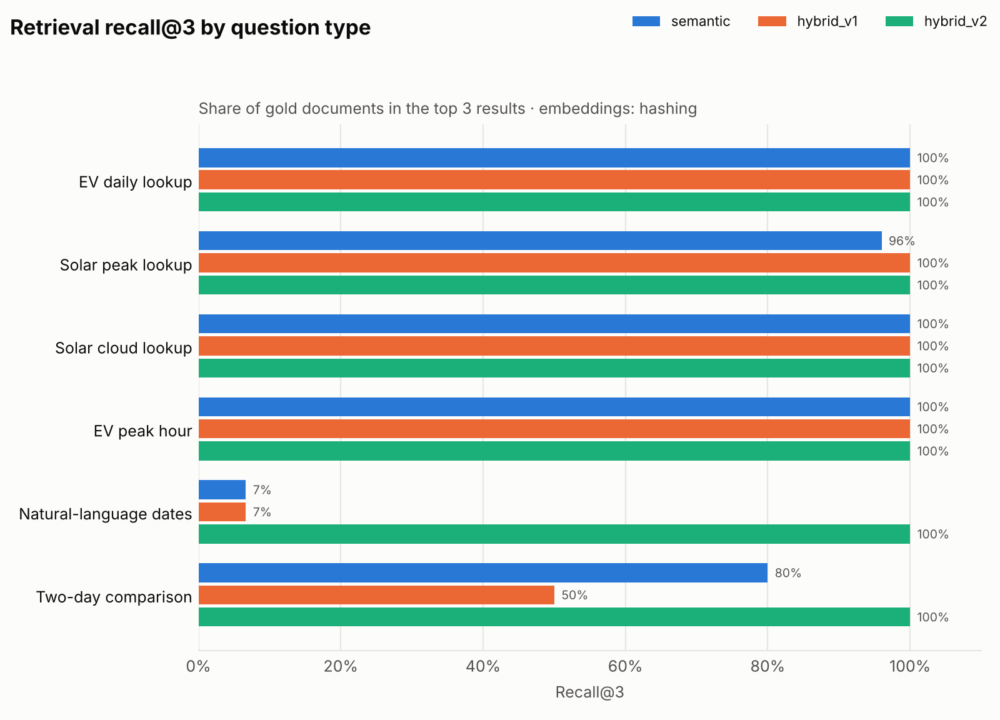
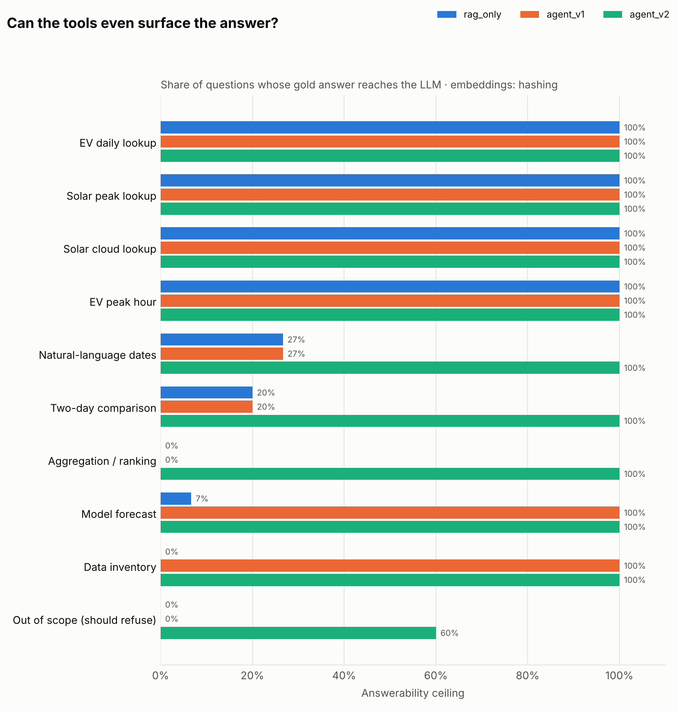
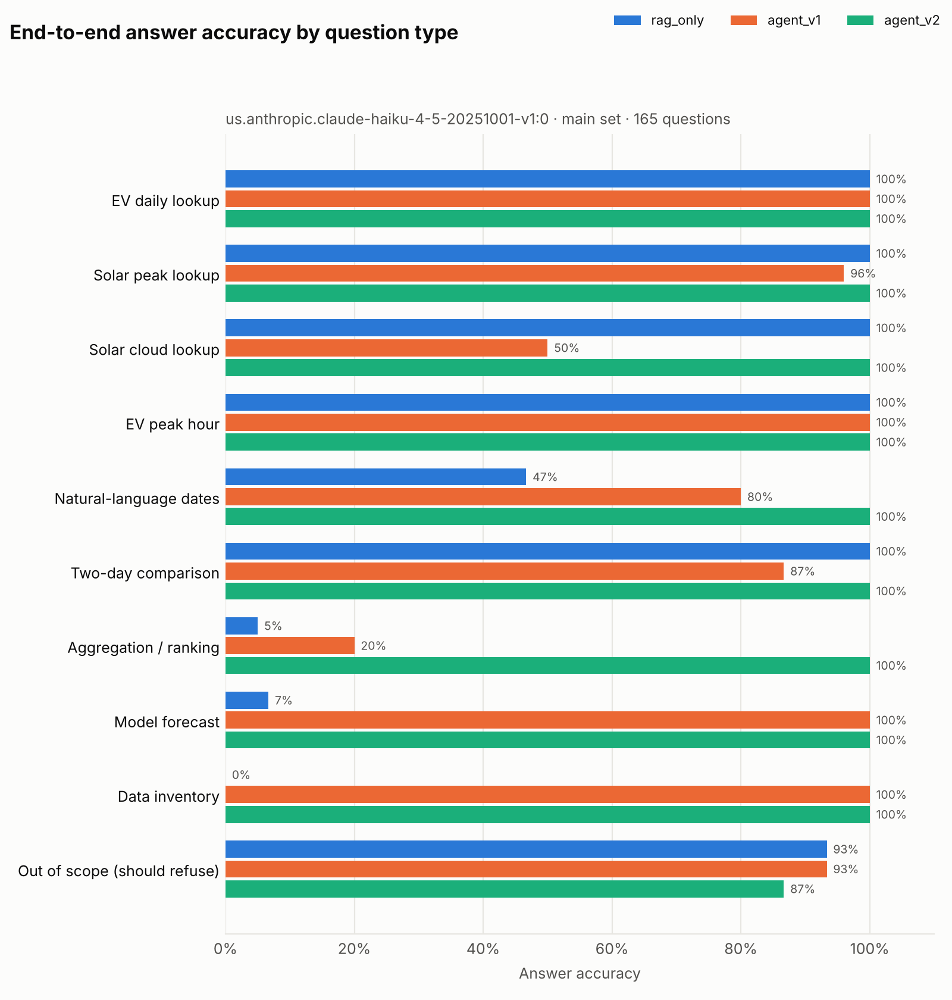
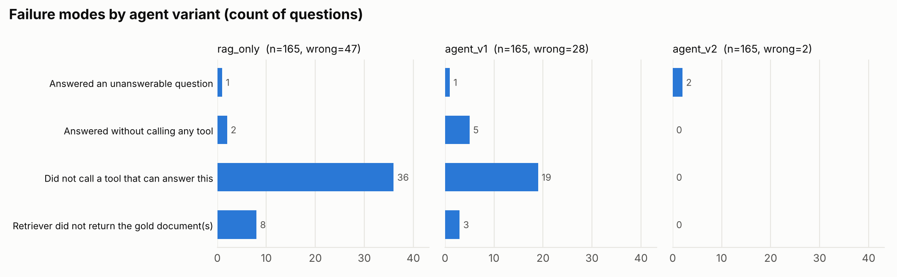
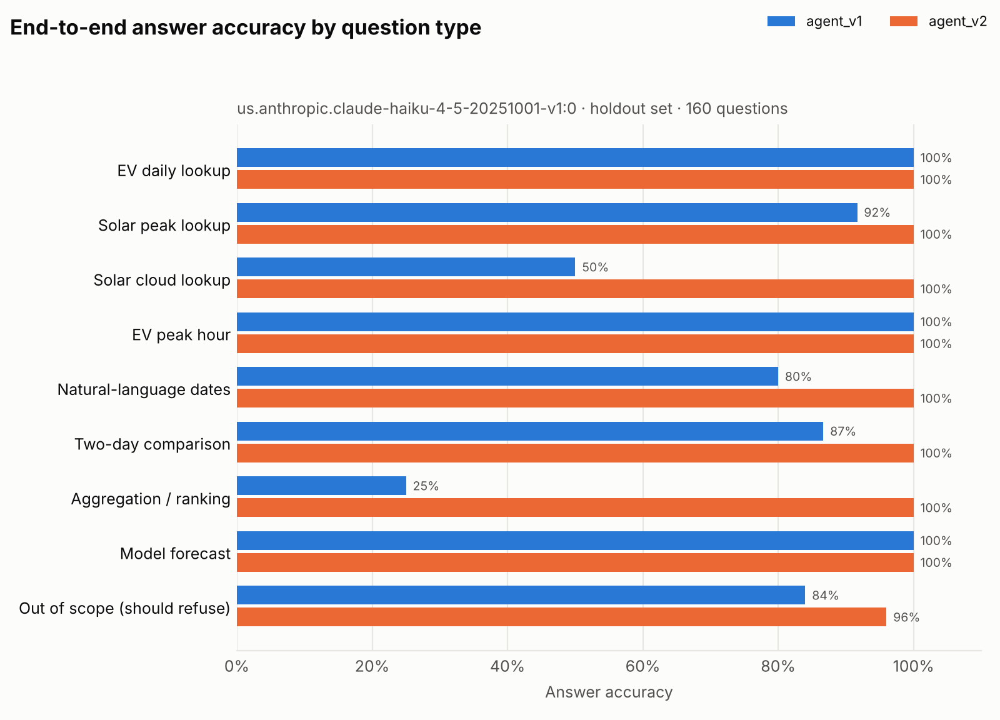

# Energy Analyst Assistant: Evaluation and Hardening Report

**Prepared for:** Grid Operations & Analytics stakeholders
**System:** Energy Analyst, an agentic RAG assistant over EV charging and solar irradiance data
**Version evaluated:** v1 (as deployed) and v2 (this engagement)
**Status of measurements:** see the box below

> **Measurement provenance.** Every figure in this report was produced by the GitHub Actions
> workflows in this repository. End-to-end results come from
> [Agent eval run #2](https://github.com/Denylson-Fuentes/rag-energy-analyst/actions/runs/44238173374):
> Claude Haiku 4.5 on Amazon Bedrock, production MiniLM embeddings, 165 questions × 3 variants,
> 0 run errors. Retrieval and ceiling results come from
> [CI run #1](https://github.com/Denylson-Fuentes/rag-energy-analyst/actions/runs/44233104401).
> Scope-rule and held-out results come from runs
> [#3](https://github.com/Denylson-Fuentes/rag-energy-analyst/actions/runs/44242318269) and
> [#4](https://github.com/Denylson-Fuentes/rag-energy-analyst/actions/runs/44242322213).
> Verbatim output for every run is in `reports/results/ci_*.txt`.
> The per-category retrieval charts were drawn with the offline hashing embedder and are
> labelled as such.

---

## 1. Executive summary

**The question.** Can operators trust the assistant's answers enough to use it for routine
lookups, and where does it break?

**What we did.** We built a 165-question evaluation set from the underlying data. Every
question has a machine-checkable gold answer. We then measured the system layer by layer:
does retrieval find the right records, can the tools surface the answer at all, and does
the LLM report it faithfully. We fixed the failure modes we found and wrapped the system in
automated tests, a container, and CI so that regressions are caught before deployment.

**Key findings (measured):**

| | Plain RAG | Deployed agent (v1) | **Hardened agent (v2, final)** |
|---|---|---|---|
| **Held-out set**, 160 questions never used for tuning | – | 84.4% | **99.4%** |
| · answerable (135) | – | 84.4% | **100%** |
| · correct refusals, out of scope (25) | – | 84.0% | **96.0%** |
| Development set, 165 questions | 71.5% | 83.0% | 100%‡ |
| Numeric claims traceable to a tool (held-out) | – | 98.9% | 98.7% |
| Latency p50 / p95 (held-out) | – | 1.8 s / 6.2 s | **1.5 s / 2.1 s** |
| Cost per query | $0.0044 | $0.0058–0.0063 | $0.0064–0.0066 |

‡ 99.4% raw; one answer the scorer missed was a correct refusal (see 4.5).

1. **On questions it was never tuned on, v2 answers every answerable question correctly:**
   135 of 135, against 114 of 135 for the deployed agent (Fisher's exact p < 10⁻⁶). Wrong
   answers fall from 25 to 1. Cost per query is about the same, and p95 latency drops from
   6.2 s to 2.1 s. On month- and year-level aggregations, v2 scores 100% against 20–25%.
2. **Most of the deployed agent's errors came from its toolset, not the model's reasoning.**
   19 of its 28 wrong answers came from not having or not choosing the right tool: 16
   aggregations, plus 3 historical questions sent to the forecast model. Another 5 were
   cloud-cover questions it declined because no tool description mentions cloud cover.
3. **Pure vector search does not work on this data.** With the production MiniLM embeddings,
   semantic search alone finds the right record in the top 3 for **1.8%** of lookup questions.
   Dates and node IDs carry the meaning, and small embedding models don't encode them. The
   metadata filter is what makes the system work, so it must be tested as carefully as the model.
4. **Retrieval defects caused confident "no data" answers when the data existed.** Plain RAG
   told users "I don't have data for June 9, 2023" for 8 of 15 natural-language-date questions,
   because the date filter ignored the date. These are false refusals that look trustworthy.
5. **Scope rules fixed the targeted failures and held up on new ones. The remaining risk is
   questions that sound like the data.** With the added rules (no vehicle types, no prices, no
   out-of-range forecasts, and end dates stated for relative dates), v2 refused 24 of 25 new
   out-of-scope questions it had never seen. The one miss: asked how loaded a *transformer*
   was, it reported EV charging energy as if that answered the question. The refusal gain over
   v1 (24/25 vs 21/25) is **not statistically significant** at this sample size (p = 0.35).
   Plain RAG labelled actual values as model predictions in 5 answers, and the numeric
   groundedness check passes such answers. The claim-level LLM judge is the control for both.
6. **We also found and fixed a production concurrency bug.** Under concurrent use, model and
   vector-store loading raced and crashed requests (5 of the first 165 harness calls failed).
   This would have surfaced as intermittent errors in the multi-user Streamlit app.

**Recommendation.** Deploy v2. It uses the same UI, model and cost per query, and on held-out
questions it removes 24 of the deployed agent's 25 wrong answers. Gate releases on three
numbers: retrieval recall@3 ≥ 0.95 (CI already enforces this), answerable accuracy ≥ 95%
(v2: 100%), and correct refusals ≥ 90% (v2: 96%, but on only 25 questions). Before relying on
the refusal rate, grow the out-of-scope set to at least 100 questions, focused on quantities
that sound like the data (transformer load, voltage, demand charges).

---

## 2. System under evaluation

| Component | v1 (deployed) | v2 (this engagement) |
|---|---|---|
| LLM | Claude Haiku 4.5 on Amazon Bedrock, temperature 0 | unchanged |
| Retrieval | Chroma + MiniLM, hybrid metadata filter (first date/node only) | multi-date/node filters, natural-language dates, explicit "no match" instead of fallback |
| Tools | search, solar forecast, EV prediction, node inventory | + `query_energy_stats` (exact totals, averages, rankings over any span) |
| Prompt | role + rules | + explicit data scope, routing guidance, "never substitute another date" |
| Reliability | unguarded lazy loading | thread-safe loading |
| Delivery | Streamlit Cloud | + Docker image, GitHub Actions CI, regression gate |

Three variants were compared throughout:

- **`rag_only`**: classic RAG (retriever + LLM, no other tools). This is the baseline that
  most "chat with your data" systems ship.
- **`agent_v1`**: the deployed agent.
- **`agent_v2`**: the hardened agent.

---

## 3. Evaluation design

### 3.1 Question set (165 questions, 10 types)

| Type | n | Example | Gold answer |
|---|---|---|---|
| EV daily lookup | 30 | *Total charging energy at GRID_07A on 2020-02-24?* | kWh (±0.1) |
| Solar peak lookup | 25 | *Peak GHI in Palm Springs on 2023-05-09?* | W/m² (±1) |
| Solar cloud lookup | 10 | *How cloudy was it on average on …?* | % (±0.6) |
| EV peak hour | 15 | *Which hour was the charging peak for GRID_LV21 on …?* | hour |
| Natural-language dates | 15 | *… on 11 August 2020?* | kWh / W/m² |
| Two-day comparison | 15 | *Was peak GHI higher on … or …? Give both values.* | both values |
| Aggregation / ranking | 20 | *Which grid node had the highest total EV charging energy in August 2020?* | node / date / total |
| Model forecast | 15 | *Run the 6-hour-ahead solar model for … What was its MAE?* | model output |
| Data inventory | 5 | *What grid nodes are available?* | node list / dates |
| Out of scope | 15 | *Peak GHI in Phoenix …*, *wholesale price …*, *GRID_LV22 on 2020-02-30* | must refuse |

**How the gold answers were built.** Questions are generated from the raw CSVs by a seeded
script (`evals/build_dataset.py`). Gold values come from independent pandas code, not the
agent's tool code, so a tool bug cannot also correct its own answer key. Sampling is
stratified across all 10 grid nodes and the full year of solar data. Phrasings vary within
each type. Lookup and comparison questions each record the IDs of the documents that contain
the answer. These IDs feed the retrieval metrics.

### 3.2 Metrics

| Metric | Definition | Why it matters to operators |
|---|---|---|
| **Retrieval recall@k** | Share of gold documents among the top *k* retrieved (k = 1, 3, 5, 10); production uses k = 3 | If the record isn't retrieved, the answer can't be right |
| **MRR** | Mean reciprocal rank of the first gold document | Ranking quality |
| **Answerability ceiling** | Share of questions where the tools return the gold answer to the model; runs without an LLM | Upper bound on accuracy; separates tool problems from model problems |
| **Answer accuracy** | Gold value present in the answer within tolerance; correct refusal for out-of-scope questions | The headline number |
| **Groundedness** | Share of the numbers the agent states that trace to a tool output (exact, rounded, or a simple difference, sum, or percent change of tool values) | Measures fabrication directly |
| **Fully grounded rate** | Share of answers with zero untraceable numbers | What an operator experiences |
| **Tool-selection accuracy** | Agent called at least one tool able to answer | Routing quality |
| **Failure mode** | Each wrong answer gets one root cause (Section 4.4) | Tells you what to fix |

**Grading.** Scoring is deterministic and unit-tested (`tests/test_scoring.py`, 30+ cases).
Every gold answer in this domain is a number, ID, date, or "no data", so exact checks are
cheaper and more reproducible than an LLM judge. An optional LLM judge (`--judge`) cross-checks
groundedness at the claim level, including non-numeric claims. It uses a different model from
the agent, so the agent never grades itself.

---

## 4. Results

### 4.1 Retrieval

*110 questions with gold documents. Same Chroma index for all three retrievers.*

**Production embeddings (MiniLM, CI run #1):**

| Retriever | Recall@1 | **Recall@3** | Recall@5 | Recall@10 | MRR |
|---|---|---|---|---|---|
| Pure semantic | 0.00 | **0.02** | 0.05 | 0.10 | 0.02 |
| Hybrid v1 (deployed) | 0.80 | **0.80** | 0.80 | 0.80 | 0.87 |
| **Hybrid v2** | 0.93 | **1.00** | 1.00 | 1.00 | 1.00 |

**Pure semantic search fails almost completely with MiniLM.** Every daily document looks the
same to a sentence embedder ("Grid Node … Date … Total Energy …"), and the model does not
distinguish 2020-08-11 from 2020-11-08. The metadata filter does the real work. Using
a bigger embedding model would not fix this; the fix is to treat identifiers as structured data.

For comparison, a lexical (hashing) embedder that matches date strings character by character
reaches 0.82 recall@3 on its own. The two hybrid retrievers score the same with either embedder,
because the filter decides the result.

Per-category view (offline hashing embedder; the hybrid columns match production):



Reading the chart:

- On ISO-dated single lookups all three retrievers are perfect. The deployed system works
  well for the questions it was demoed on.
- **Natural-language dates** fail almost completely for v1 (7%). The date regex only
  recognises `YYYY-MM-DD`, so the date filter is never applied.
- **On comparisons, v1 retrieves at most half the evidence (50%).** v1 applies a filter for
  the *first* date only, which excludes the second day by construction. With a lexical
  embedder, unfiltered search actually beats v1 here (73%).
- Recall@1 for v2 is 0.93 rather than 1.00 only because comparisons have two gold documents.
- Pure-semantic figures move by about ±0.02 between index rebuilds, because Chroma's HNSW index
  is approximate and not bit-for-bit reproducible. The filtered (hybrid) figures are stable.

### 4.2 Tool-layer answerability ceiling (no LLM)

*Production MiniLM embeddings, CI run #1:*

| | rag_only | agent_v1 | **agent_v2** |
|---|---|---|---|
| **Overall ceiling** | 53% | 64% | **96%** |
| Lookups: EV, solar peak, cloud, peak hour (80) | 100% | 100% | 100% |
| Aggregation / ranking (20) | 0% | 0% | 100% |
| Two-day comparison (15) | 20% | 20% | 100% |
| Natural-language dates (15) | 20%* | 20%* | 100% |
| Model forecast (15) | 7% | 100% | 100% |
| Data inventory (5) | 0% | 100% | 100% |
| Out of scope, "no data" signalled (15) | 0% | 0% | 60% |


*(Chart from the offline embedder: identical except natural-language dates for v1, 27%.)*

\* Slightly above retrieval recall because, by coincidence, a gold value sometimes appears
in a wrong day's document. The ceiling is therefore an *upper* bound for v1.

**Interpretation.** The ceiling assumes the tool is called with the question text as written.
The end-to-end run (4.3) shows where that assumption breaks. The LLM rewrites queries, issuing
one search per date and often converting "June 9, 2023" to ISO, so it recovers most comparison
and some natural-language-date questions that the ceiling counts as lost. Where no rewriting
can help, the ceiling held. For aggregations, v1 scored 20% and plain RAG 5%, against a 0%
ceiling. For forecasts and inventory, plain RAG has no tool, and it scored 7% and 0%.

### 4.3 End-to-end agent accuracy and groundedness

*Claude Haiku 4.5 on Bedrock, temperature 0, MiniLM index, 165 questions per variant, 0 run errors.*

| Metric | rag_only | agent_v1 | **agent_v2** |
|---|---|---|---|
| Answer accuracy (165) | 71.5% | 83.0%† | **98.8%** |
| Accuracy, answerable (150) | 69.3% | 82.0% | **100%** |
| Correct refusals (15 out of scope) | 93.3% | 93.3%† | 86.7% |
| Tool-selection accuracy | 75.8% | 79.4% | **100%** |
| Groundedness, numeric claims | 98.3% | 98.2% | 97.7% |
| Answers with every number traceable | 94.4% | 94.8% | 94.7% |
| LLM calls per query | 2.18 | 2.21 | 1.95 |
| Latency p50 / p95 | 1.77 s / 3.90 s | 1.76 s / 5.16 s | **1.50 s / 2.14 s** |
| Cost per query (Haiku 4.5 list price) | $0.0044 | $0.0063 | $0.0063 |

† Includes a documented manual correction. Reviewing all 79 raw failure cases found two answers
from agent_v1 that the scorer marked wrong but were correct refusals: "the date … is invalid"
and "the dataset does not specify vehicle type". The refusal pattern was fixed and tests were
added for both (`tests/test_scoring.py`). Raw scorer output: 81.8% and 80.0%.



| Accuracy by type | rag_only | agent_v1 | agent_v2 |
|---|---|---|---|
| Lookups: EV, solar peak, peak hour (70) | 100% | 99% | 100% |
| Solar cloud cover (10) | 100% | **50%** | 100% |
| Natural-language dates (15) | 47% | 80% | 100% |
| Two-day comparison (15) | 100% | 87% | 100% |
| Aggregation / ranking (20) | **5%** | **20%** | 100% |
| Model forecast (15) | 7% | 100% | 100% |
| Data inventory (5) | 0% | 100% | 100% |
| Out of scope (15) | 93% | 93% | 87% |

**Reading it.**

- **Plain RAG is excellent at what it was designed for and fails silently outside it.**
  It is perfect on single-day lookups and, thanks to query rewriting, on comparisons. It cannot
  aggregate, forecast, or list inventory. Instead of saying "I can't do that", it often said
  the data didn't exist ("I don't have data for July 2023"), which is false.
- **Adding tools without telling the model when to use them created new errors.** agent_v1 lost
  half the cloud-cover questions, which plain RAG got right. Its tool descriptions never mention
  cloud cover, so the model answered "I don't have a tool for cloud cover" without searching. It
  also sent 3 historical solar questions to the forecast tool. Tool descriptions are part of the
  model's interface and need the same care as code.
- **Groundedness is high everywhere (≈98%) but measures something narrower than "correct".** It
  confirms numbers weren't invented. It does not catch a real number given the wrong label, as
  in the RAG-only forecast answers below.

### 4.4 Failure-mode breakdown (development set)

Root causes found so far (tool layer, measured), with the fix applied in v2:

| Failure mode | Affected (v1) | Root cause | v2 fix | Ceiling after |
|---|---|---|---|---|
| **Silent fallback to wrong records** | 15 / 15 out-of-scope | A filter matching nothing fell back to unfiltered search | Explicit "no documents match", and the prompt forbids substitution | 9 / 15 caught by tools; 6 rely on the LLM |
| **Aggregation impossible** | 20 / 20 | Top-3 retrieval cannot sum or rank 30–900 days | `query_energy_stats` analytics tool | 20 / 20 |
| **Second entity dropped** | 12 / 15 comparisons | Constraint parser kept the first date/node only | `$in` filters over every date/node; k widened | 15 / 15 |
| **Natural-language dates ignored** | 12 / 15 | Regex recognised ISO dates only | Date parser for 5 formats | 15 / 15 |
| **Wrong source filter** | latent | Substring match: "ev" in "every", "level", "seven" | Word-boundary keyword match | (unit-tested) |
| **Impossible dates** | 2 / 2 | 2020-02-30 silently dropped, so other days were returned | Flagged as invalid | 2 / 2 |
| **Concurrency crash** | 5 / 165 harness calls | Unlocked lazy init of Chroma client and model globals | Locks | 0 / 165 |

End to end, every wrong answer gets one root-cause label:



| Failure mode | rag_only | agent_v1 | agent_v2 | Representative case (from the traces) |
|---|---|---|---|---|
| No tool could answer / wrong tool | 36 | 19 | 0 | v1, Feb 2021 total: *"the search tool returns point-in-time data rather than monthly summaries"* |
| Retriever missed the gold document | 8 | 3 | 0 | RAG, "June 9, 2023": *"I don't have data for June 9, 2023"* (the data exists) |
| Answered without calling a tool | 2 | 5 | 0 | v1, cloud cover: *"I don't have a tool available to retrieve cloud cover data"* |
| Answered an out-of-scope question | 1 | 1 | 2 | v2, electric buses: *"1 electric bus charged at GRID_08A"* |
| **Total wrong** | **47** | **28** | **2** | |

Two patterns deserve attention because simple metrics miss them:

- **Grounded but mislabelled.** Asked for the EV model's *prediction*, plain RAG answered
  *"the model predicts a total EV load of 44.20 kWh"*. 44.20 kWh is the *actual* measured value.
  The answer is wrong, yet it counts as fully grounded. Five of plain RAG's forecast answers
  look like this.
- **Plausible arithmetic from partial data.** agent_v1, asked how many days GRID_LV11 was
  active in 2019, estimated *"approximately 112 days … calculated from the 480 total days"*
  by interpolating coverage dates. That is a fabricated statistic built from real inputs.
  v2 answers it exactly with the analytics tool.

### 4.5 Scope rules and held-out validation

**What changed.** Two rules were added to v2's prompt after the development run:

- The data has no vehicle types, no prices or costs, and no forecasts beyond the data range.
  Say so instead of answering a nearby question.
- For relative dates ("yesterday", "next Tuesday"), state the data's end dates
  (EV: 2021-10-11, solar: 2023-12-31) rather than asking which date was meant.

These rules were written in response to v2's two development-set failures, so re-scoring the
development set alone would overstate their effect. A **held-out set** was built to measure
generalisation:

- **135 answerable questions**, regenerated with a different random seed. They share no
  question with the development set. They use the same templates, so they test new dates and
  nodes, not new phrasings.
- **25 out-of-scope questions**, written after the rules on topics the development set never
  asks about: vehicle make (Teslas, plug-in hybrids), cost, tariffs, revenue, "yesterday",
  "this weekend", "tomorrow", forecasts for 2022–2024, voltage, transformer loading, CO₂,
  driver identity, charger brand, other cities, unknown nodes, and an impossible date.

**Development set, v2 before and after the rules** ([run #3](https://github.com/Denylson-Fuentes/rag-energy-analyst/actions/runs/44242318269)):

| | v2 before rules | v2 with rules |
|---|---|---|
| Accuracy (165) | 98.8% | 100%‡ |
| Answerable (150) | 100% | 100% |
| Correct refusals (15) | 86.7% | 100%‡ |
| Fully grounded answers | 94.7% | 96.1% |
| Latency p50 · cost per query | 1.50 s · $0.0063 | 1.70 s · $0.0066 |

‡ The scorer marked one answer wrong: *"The data records unique vehicles rather than vehicle
types, so I cannot determine how many of those were electric buses."* That is a correct
answer. The refusal pattern was extended to cover it, with a test. Raw: 99.4% and 93.3%. No
answerable question regressed.

**Held-out set, v1 vs v2** ([run #4](https://github.com/Denylson-Fuentes/rag-energy-analyst/actions/runs/44242322213)):

| | agent_v1 | **agent_v2** | 95% CI (v2) |
|---|---|---|---|
| Accuracy (160) | 84.4% | **99.4%** | 96.6–100% |
| Answerable (135) | 84.4% | **100%** | 97.3–100% |
| Correct refusals (25) | 84.0% | **96.0%** | 79.6–99.9% |
| False refusals on answerable questions | 9.6% | **0%** | |
| Tool-selection accuracy | 83.8% | **100%** | |
| Groundedness, numeric claims | 98.9% | 98.7% | |
| Answers fully grounded | 95.4% | 97.8% | |
| Latency p50 / p95 | 1.78 s / 6.22 s | **1.51 s / 2.06 s** | |
| Cost per query | $0.0058 | $0.0064 | |



All 26 held-out failure cases were reviewed by hand. No scorer errors were found.

- **v1's failures reproduce the development-set pattern on new data.** It has no tool for
  aggregations (9 of 12 wrong), declines cloud-cover questions (5 of 10), sends historical
  solar questions to the forecast tool (4), misses written-out dates (3), and asks the user for
  today's date on relative-date questions (3). These are structural, so they recur.
- **v2's one held-out failure is a new failure type.** *"How loaded was the transformer at
  GRID_LV21 on 2020-06-02?"* drew *"the transformer … was lightly loaded. It delivered 6.54 kWh
  of energy…"*. The model substituted a related quantity it does have (EV energy) for one it
  doesn't (transformer load). The rules list specific missing fields, and this one wasn't
  listed. Listing more fields only moves the boundary. The general fix is a rule like "if the
  question names a quantity that is not one of the dataset's fields, say so", plus a larger
  out-of-scope set to measure it.

**How much to trust these numbers.**

- The **answerable** result is strong. Going from 114/135 to 135/135 is significant
  (Fisher's exact p < 10⁻⁶), and the lower bound of v2's 95% interval is 97%.
- The **refusal** result is directionally good but under-powered. 24/25 vs 21/25 has p = 0.35,
  and v2's interval spans 80–100%. Treat 96% as "probably above 80%", not as a measured rate.
- Each variant ran once. Temperature is 0, but Bedrock outputs are not guaranteed identical
  across runs.

---

## 5. Engineering deliverables

| Deliverable | Where | What it guarantees |
|---|---|---|
| Evaluation sets + generator | `evals/data/questions.jsonl` (165, development), `questions_holdout.jsonl` (160, held-out), `evals/build_dataset.py` | Reproducible; tests assert both regenerate identically and share no question |
| Scorers + taxonomy | `evals/scoring.py` | Deterministic, unit-tested |
| Runners | `evals/run_retrieval_eval.py`, `run_ceiling.py`, `run_agent_eval.py` | Layered diagnosis; traces stored for re-scoring |
| Report generator | `evals/report.py` → `reports/metrics.md`, `reports/figures/` | Numbers in this report regenerate from results files |
| Test suite (81 tests) | `tests/` | Runs offline in ~10 s, including an end-to-end agent-loop test with a scripted model |
| Container | `Dockerfile` | Index baked in; `--target test` fails the build if lint or tests fail; health check |
| CI | `.github/workflows/ci.yml` | Lint + tests → MiniLM retrieval eval with **recall@3 ≥ 0.95 gate** → Docker build and health check. All green on [run #1](https://github.com/Denylson-Fuentes/rag-energy-analyst/actions/runs/44233104401) |
| Paid eval on demand | `.github/workflows/eval.yml` | One-click LLM evaluation with uploaded artifacts |

---

## 6. Limitations and risks

- **The held-out set shares templates with the development set.** It tests new dates, nodes
  and out-of-scope topics, not new phrasings of answerable questions. Real operator wording
  (typos, follow-ups, mixed questions) is still untested.
- **Out-of-scope coverage is thin.** 40 questions in total across both sets. The confidence
  interval on refusals is wide, and the one held-out miss shows a whole category
  (plausible-sounding quantities not in the data) that needs dedicated coverage.
- **Templated questions.** Phrasings are varied but synthetic. Real operator questions will
  be messier (typos, relative dates such as "last Tuesday", follow-ups). Sample 50 real
  queries from logs and add them as a second set.
- **Forecast questions test routing and reporting, not forecast skill.** Their gold is the
  model's own output. Forecast accuracy belongs to the model-training pipeline.
- **The answer matcher is lenient, and right-for-the-wrong-reason answers count as correct.**
  "Any number within tolerance" can credit an answer that lists many numbers. Some of v1's 4
  correct aggregation answers may be informed guesses from partial data (the largest node usually
  wins). The full failure review found two scorer false negatives (now fixed) and no false
  positives among failures, but correct answers were not individually audited.
- **One run per variant.** Temperature is 0, but Bedrock outputs are not guaranteed
  deterministic. With 15 out-of-scope questions, one answer moves the refusal rate by 6.7
  points, so differences of that size between variants are within noise.
- **Unfiltered questions depend on a weak embedder.** MiniLM gives 2% recall without filters.
  Any question that carries no date or node ID, such as "show me a cloudy day", is served
  poorly. That category isn't in this set yet, and a better embedder or BM25 hybrid search
  should be evaluated if it matters to users.
- **The ML models are pickles from an older scikit-learn.** They load with version warnings.
  Retrain under the pinned version (`scripts/retrain_*.py`) before the next release.

---

## 7. Recommended next steps

1. **Ship v2.** The held-out run supports it on every measured dimension.
2. **Add a general "unknown quantity" rule and grow the out-of-scope set** to 100+ questions,
   weighted towards quantities that sound like the data (transformer load, voltage, demand
   charges, state of charge). Re-run and report refusals with confidence intervals.
3. **Turn on the claim-level judge** (`--judge`, needs an `ANTHROPIC_API_KEY` secret) to catch
   grounded-but-mislabelled answers that the numeric check passes.
4. **Build a real-query set** from production logs (50+ questions), as in Section 6.
5. **Add observability.** Log tool calls and the groundedness score per production answer,
   and alert on a falling grounded rate.

---

### Appendix A: Reproduce

```bash
make install            # CPU torch + dev requirements
make test               # 81 tests, offline (~10 s)
make eval-offline       # retrieval + ceiling + figures, no LLM, no model download
make eval-agent         # end-to-end, needs LLM_PROVIDER + credentials
make docker-test        # builds the image and runs the suite inside it
```

### Appendix B: File map

```
evals/
  build_dataset.py      seeded generator, independent gold answers
  data/questions.jsonl  165 questions
  scoring.py            accuracy, groundedness, failure taxonomy
  run_retrieval_eval.py recall@k / MRR, 3 retrievers, CI gate
  run_ceiling.py        tool-layer answerability ceiling
  run_agent_eval.py     end-to-end runner + scorer (traces → results)
  judge.py              optional LLM groundedness judge
  report.py             metrics.md + figures
reports/
  client_report.md      this document
  metrics.md            auto-generated tables
  figures/, results/
```
